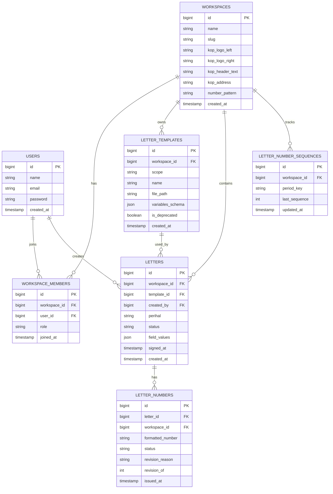

# DATABASE.md: SuratinAja

## 1. Prinsip Desain Data

| Prinsip | Implementasi |
|:---|:---|
| Isolasi per workspace | Semua tabel transaksional memiliki `workspace_id`; seluruh query di-scope via global scope Eloquent. |
| Integritas nomor surat (DEC-002, DEC-005) | Tabel `letter_number_sequences` menyimpan counter per workspace+periode; constraint unik pada `(workspace_id, formatted_number)`. |
| Audit revisi (DEC-005) | Nomor lama tidak dihapus, melainkan diubah statusnya ke `HANGUS` pada `letter_numbers`. |
| Multi-template (DEC-001) | `letter_templates` membedakan `scope = GLOBAL` (read-only, `workspace_id NULL`) vs `WORKSPACE`. |
| Tanda tangan fisik (DEC-004) | Status surat dikelola murni sebagai state machine di `letters.status`. |

## 2. ERD



## 3. Definisi Tabel Inti

### 3.1 `workspaces`

| Kolom | Tipe | Constraint | Keterangan |
|:---|:---|:---|:---|
| id | BIGINT UNSIGNED | PK, AUTO_INCREMENT | |
| name | VARCHAR(120) | NOT NULL | Nama organisasi/panitia |
| slug | VARCHAR(120) | NOT NULL, UNIQUE | Identifier URL |
| kop_logo_left | VARCHAR(255) | NULL | Path logo kiri (FR-03) |
| kop_logo_right | VARCHAR(255) | NULL | Path logo kanan |
| kop_header_text | VARCHAR(255) | NULL | Teks header kop |
| kop_address | VARCHAR(255) | NULL | Alamat pada kop |
| number_pattern | VARCHAR(255) | NOT NULL | Pola token (DEC-002), mis. `{seq}/{kode}/{bulan_romawi}/{tahun}` |
| created_at / updated_at | TIMESTAMP | NULL | |

Index: `UNIQUE(slug)`.

### 3.2 `letters`

| Kolom | Tipe | Constraint | Keterangan |
|:---|:---|:---|:---|
| id | BIGINT UNSIGNED | PK | |
| workspace_id | BIGINT UNSIGNED | FK → workspaces.id, NOT NULL | Isolasi data |
| template_id | BIGINT UNSIGNED | FK → letter_templates.id, NOT NULL | |
| created_by | BIGINT UNSIGNED | FK → users.id, NOT NULL | |
| perihal | VARCHAR(255) | NOT NULL | Subjek surat |
| status | ENUM('DRAFT','MENUNGGU_TTD','SELESAI') | NOT NULL, DEFAULT 'DRAFT' | State machine DEC-004 |
| field_values | JSON | NOT NULL | Nilai `${...}` hasil form dinamis (FR-02) |
| signed_at | TIMESTAMP | NULL | Diisi saat transisi ke SELESAI |
| created_at / updated_at | TIMESTAMP | NULL | |

Index: `INDEX(workspace_id, status)`, `INDEX(workspace_id, perihal)`.

### 3.3 `letter_numbers`

| Kolom | Tipe | Constraint | Keterangan |
|:---|:---|:---|:---|
| id | BIGINT UNSIGNED | PK | |
| letter_id | BIGINT UNSIGNED | FK → letters.id, NOT NULL | |
| workspace_id | BIGINT UNSIGNED | FK → workspaces.id, NOT NULL | Denormalisasi untuk constraint |
| formatted_number | VARCHAR(120) | NOT NULL | Hasil render pola |
| status | ENUM('AKTIF','HANGUS') | NOT NULL, DEFAULT 'AKTIF' | DEC-005 |
| revision_reason | TEXT | NULL | Wajib saat revisi (FR-07) |
| revision_of | BIGINT UNSIGNED | NULL, FK → letter_numbers.id | Menunjuk nomor yang digantikan |
| issued_at | TIMESTAMP | NOT NULL | |

Index: `UNIQUE(workspace_id, formatted_number)`, `INDEX(letter_id)`.

### 3.4 `letter_templates`

| Kolom | Tipe | Constraint | Keterangan |
|:---|:---|:---|:---|
| id | BIGINT UNSIGNED | PK | |
| workspace_id | BIGINT UNSIGNED | FK → workspaces.id, NULL | NULL = template GLOBAL (DEC-001) |
| scope | ENUM('GLOBAL','WORKSPACE') | NOT NULL | |
| name | VARCHAR(150) | NOT NULL | |
| file_path | VARCHAR(255) | NOT NULL | Lokasi `.docx` |
| variables_schema | JSON | NOT NULL | Hasil parsing `${...}` (FR-02) |
| is_deprecated | BOOLEAN | NOT NULL, DEFAULT 0 | |
| created_at / updated_at | TIMESTAMP | NULL | |

Index: `INDEX(scope, workspace_id)`.

### 3.5 `letter_number_sequences`

| Kolom | Tipe | Constraint | Keterangan |
|:---|:---|:---|:---|
| id | BIGINT UNSIGNED | PK | |
| workspace_id | BIGINT UNSIGNED | FK → workspaces.id, NOT NULL | |
| period_key | VARCHAR(16) | NOT NULL | Mis. `2025` atau `2025-03` |
| last_sequence | INT UNSIGNED | NOT NULL, DEFAULT 0 | Counter atomik |
| updated_at | TIMESTAMP | NULL | |

Index: `UNIQUE(workspace_id, period_key)` — mencegah race condition (PRD §8).

## 4. Prisma Schema

> Catatan: Proyek ini menggunakan Laravel + Eloquent, bukan Prisma. Skema berikut disajikan sebagai kontrak struktural setara (copy-ready untuk generator) dan memetakan 1:1 ke migrasi Laravel di atas.

```prisma
generator client {
  provider = "prisma-client-js"
}

datasource db {
  provider = "mysql"
  url      = env("DATABASE_URL")
}

model Workspace {
  id             BigInt   @id @default(autoincrement())
  name           String   @db.VarChar(120)
  slug           String   @unique @db.VarChar(120)
  kopLogoLeft    String?  @map("kop_logo_left") @db.VarChar(255)
  kopLogoRight   String?  @map("kop_logo_right") @db.VarChar(255)
  kopHeaderText  String?  @map("kop_header_text") @db.VarChar(255)
  kopAddress     String?  @map("kop_address") @db.VarChar(255)
  numberPattern  String   @map("number_pattern") @db.VarChar(255)
  createdAt      DateTime @default(now()) @map("created_at")
  updatedAt      DateTime @updatedAt @map("updated_at")

  members    WorkspaceMember[]
  templates  LetterTemplate[]
  letters    Letter[]
  numbers    LetterNumber[]
  sequences  LetterNumberSequence[]

  @@map("workspaces")
}

model User {
  id        BigInt   @id @default(autoincrement())
  name      String   @db.VarChar(120)
  email     String   @unique @db.VarChar(150)
  password  String   @db.VarChar(255)
  createdAt DateTime @default(now()) @map("created_at")

  memberships WorkspaceMember[]
  letters     Letter[]

  @@map("users")
}

model WorkspaceMember {
  id          BigInt   @id @default(autoincrement())
  workspaceId BigInt   @map("workspace_id")
  userId      BigInt   @map("user_id")
  role        Role     @default(SEKRETARIS)
  joinedAt    DateTime @default(now()) @map("joined_at")

  workspace Workspace @relation(fields: [workspaceId], references: [id], onDelete: Cascade)
  user      User      @relation(fields: [userId], references: [id], onDelete: Cascade)

  @@unique([workspaceId, userId])
  @@map("workspace_members")
}

model LetterTemplate {
  id               BigInt   @id @default(autoincrement())
  workspaceId      BigInt?  @map("workspace_id")
  scope            TemplateScope
  name             String   @db.VarChar(150)
  filePath         String   @map("file_path") @db.VarChar(255)
  variablesSchema  Json     @map("variables_schema")
  isDeprecated     Boolean  @default(false) @map("is_deprecated")
  createdAt        DateTime @default(now()) @map("created_at")
  updatedAt        DateTime @updatedAt @map("updated_at")

  workspace Workspace? @relation(fields: [workspaceId], references: [id], onDelete: Cascade)
  letters   Letter[]

  @@index([scope, workspaceId])
  @@map("letter_templates")
}

model Letter {
  id          BigInt    @id @default(autoincrement())
  workspaceId BigInt    @map("workspace_id")
  templateId  BigInt    @map("template_id")
  createdBy   BigInt    @map("created_by")
  perihal     String    @db.VarChar(255)
  status      LetterStatus @default(DRAFT)
  fieldValues Json      @map("field_values")
  signedAt    DateTime? @map("signed_at")
  createdAt   DateTime  @default(now()) @map("created_at")
  updatedAt   DateTime  @updatedAt @map("updated_at")

  workspace Workspace      @relation(fields: [workspaceId], references: [id], onDelete: Cascade)
  template  LetterTemplate @relation(fields: [templateId], references: [id])
  author    User           @relation(fields: [createdBy], references: [id])
  numbers   LetterNumber[]

  @@index([workspaceId, status])
  @@index([workspaceId, perihal])
  @@map("letters")
}

model LetterNumber {
  id              BigInt        @id @default(autoincrement())
  letterId        BigInt        @map("letter_id")
  workspaceId     BigInt        @map("workspace_id")
  formattedNumber String        @map("formatted_number") @db.VarChar(120)
  status          NumberStatus  @default(AKTIF)
  revisionReason  String?       @map("revision_reason") @db.Text
  revisionOf      BigInt?       @map("revision_of")
  issuedAt        DateTime      @default(now()) @map("issued_at")

  letter    Letter     @relation(fields: [letterId], references: [id], onDelete: Cascade)
  workspace Workspace  @relation(fields: [workspaceId], references: [id], onDelete: Cascade)

  @@unique([workspaceId, formattedNumber])
  @@index([letterId])
  @@map("letter_numbers")
}

model LetterNumberSequence {
  id           BigInt   @id @default(autoincrement())
  workspaceId  BigInt   @map("workspace_id")
  periodKey    String   @map("period_key") @db.VarChar(16)
  lastSequence Int      @default(0) @map("last_sequence") @db.UnsignedInt
  updatedAt    DateTime @updatedAt @map("updated_at")

  workspace Workspace @relation(fields: [workspaceId], references: [id], onDelete: Cascade)

  @@unique([workspaceId, periodKey])
  @@map("letter_number_sequences")
}

enum Role {
  ADMIN
  SEKRETARIS
  KETUA
}

enum TemplateScope {
  GLOBAL
  WORKSPACE
}

enum LetterStatus {
  DRAFT
  MENUNGGU_TTD
  SELESAI
}

enum NumberStatus {
  AKTIF
  HANGUS
}
```

### Catatan Partial Index

Constraint unik `letter_numbers(workspace_id, formatted_number)` berlaku global per workspace (termasuk baris `HANGUS`), sehingga nomor yang dihanguskan tidak dapat dipakai ulang — sesuai prinsip integritas riwayat DEC-005. Tidak diperlukan partial unique index; bila kelak dibutuhkan pengecualian, terapkan via raw SQL migration:

```sql
-- Partial index — apply via raw SQL migration
CREATE UNIQUE INDEX uq_active_letter_number
  ON letter_numbers (workspace_id, formatted_number)
  WHERE status = 'AKTIF';
```

## 5. Aturan Integritas & Transaksi

| Operasi | Aturan |
|:---|:---|
| Generate nomor (DEC-002) | `DB::transaction`: `SELECT ... FOR UPDATE` pada `letter_number_sequences` → increment `last_sequence` → render pola → insert `letter_numbers`. |
| Revisi nomor (DEC-005) | Update baris lama `status='HANGUS'` + `revision_reason`; insert baris baru dengan `revision_of` = id lama. |
| Scope isolasi | Global scope Eloquent `where('workspace_id', auth()->user()->activeWorkspaceId)`. |
| Template GLOBAL (DEC-001) | `scope='GLOBAL'` → `workspace_id NULL`, read-only; duplikasi menghasilkan baris baru `scope='WORKSPACE'`. |
| Retensi file `.docx` | TBD (PRD §9). |


## 6. Penambahan Skema & Normalisasi Implementasi

Berikut kolom dan tabel tambahan yang diterapkan pada migrasi Laravel untuk memenuhi kebutuhan fitur di `FEATURES.md`, `TASKS.md`, dan hasil diskusi rencana implementasi:

- **Normalisasi nilai enum (sesuai kontrak `API.md`):**
  - `workspace_members.role`: `'admin'`, `'secretary'`, `'chairman'` (label UI: Admin, Sekretaris, Ketua).
  - `letters.status`: `'draft'`, `'menunggu_ttd'`, `'selesai'`, `'dibatalkan'`.
  - `letter_numbers.status`: `'aktif'`, `'hangus'`.
  - `letter_templates.scope`: `'global'`, `'workspace'`.
- **Kolom tambahan pada tabel eksisting:**
  - `users.current_workspace_id` (`FK -> workspaces.id`), `users.is_super_admin` (`BOOLEAN`).
  - `workspaces.number_code` (`VARCHAR(40)` untuk token `{kode}`), `workspaces.seq_padding` (`TINYINT UNSIGNED`, default `3`).
  - `letter_templates.version` (`INT UNSIGNED`), `letter_templates.source_template_id` (`FK -> letter_templates.id` untuk jejak duplikasi global → workspace).
  - `letters.letter_date` (`DATE`), `letters.generated_file_path`, `letters.preview_pdf_path`, `letters.bulk_job_id`, `letters.duplicated_from_id`, `letters.version`, `letters.cancel_reason`, `letters.cancelled_at`.
- **Tabel pendukung:**
  - `workspace_invitations`: undangan anggota berstatus `pending`/`accepted`/`revoked` (MOD-01 §2.2).
  - `bulk_jobs`: pelacakan progres antrean bulk (`queued`/`processing`/`done`/`failed`), jumlah penerima, baris gagal (`failed_rows`), dan lokasi file `.docx` gabungan (MOD-05).
  - `letter_revisions`: riwayat versi revisi surat, mode (`new_number`/`keep_number`), nomor lama & baru, alasan revisi, dan aktor (MOD-06 §7.2).
  - `letter_activities`: jejak audit aktivitas surat (`created`, `edited`, `status_changed`, `revised`, `cancelled`, `duplicated`).
